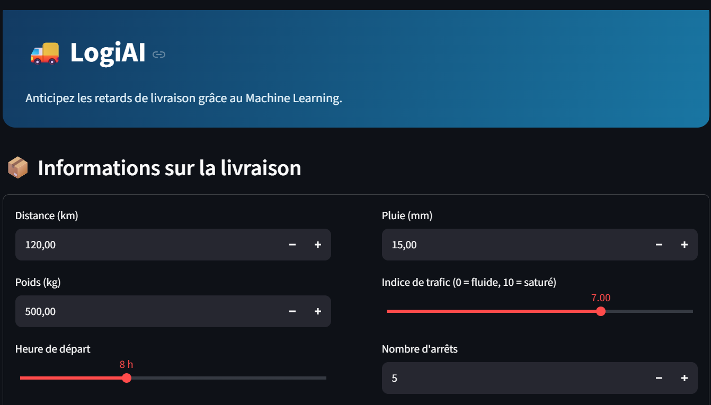
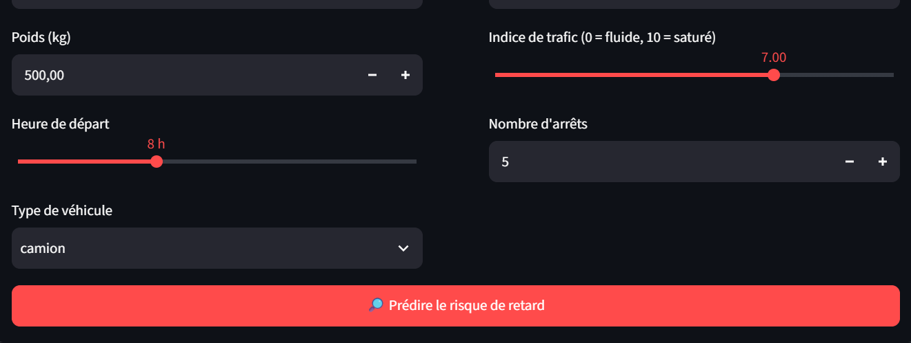
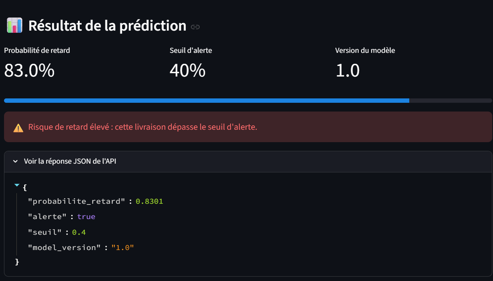
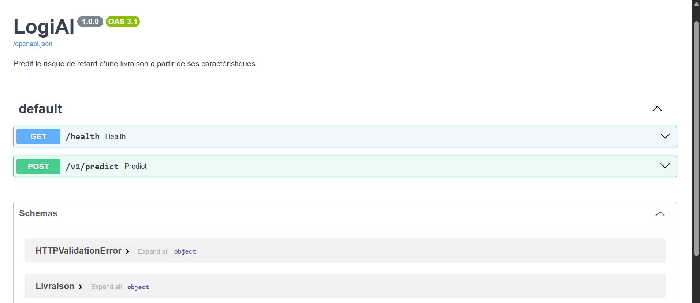
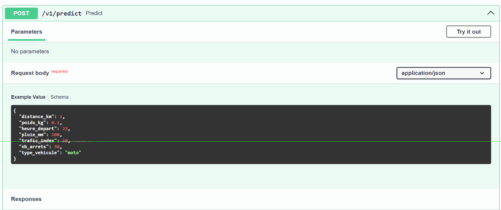
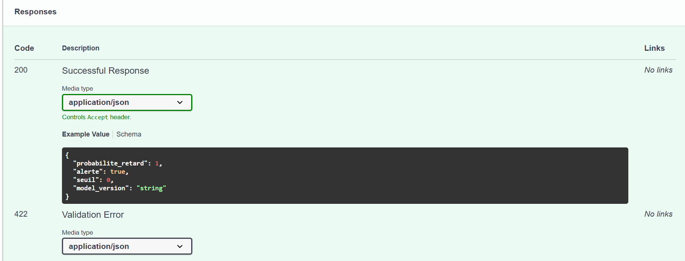

# Compte rendu du TP — LogiAI

**Projet :** Prédiction du risque de retard de livraison avec Machine Learning, FastAPI et Streamlit  
**Nom :** BENATIK 
**Groupe :** Adnane  
**Date :** 28 octobre 2026

## 1. Objectif du TP

Le projet **LogiAI** vise à estimer la probabilité qu'une livraison arrive en retard à partir de caractéristiques opérationnelles : distance, poids, heure de départ, précipitations, circulation, nombre d'arrêts et type de véhicule. Le modèle de Machine Learning est exposé par une API REST développée avec **FastAPI**. Une interface web **Streamlit** permet de renseigner les caractéristiques et de consulter les résultats sans écrire de requête HTTP.

## 2. Environnement et technologies

- **Python** et environnement virtuel `.venv` pour isoler les dépendances.
- **pandas**, **NumPy** et **scikit-learn** pour les données et l'apprentissage automatique.
- **joblib** pour sauvegarder et recharger le modèle.
- **FastAPI**, **Pydantic** et **Uvicorn** pour l'API et la validation des entrées.
- **Streamlit** et **requests** pour l'interface web et l'appel de l'API.
- **pytest** et **httpx** pour les tests automatisés.

Le projet comprend notamment `logiai/dataset.py`, `logiai/train.py`, `logiai/predict.py`, `logiai/api/`, `tests/`, `requirements.txt` et `streamlit_app.py`.

## 3. Installation et démarrage

Dans le dossier qui contient `requirements.txt` :

```powershell
# Activer l'environnement virtuel existant (adapter le chemin selon l'emplacement)
..\.venv\Scripts\Activate.ps1

# Installer les dépendances
python -m pip install -r requirements.txt --default-timeout=300 --retries 10

# Générer les données puis entraîner le modèle
python -m logiai.dataset
python -m logiai.train
```

Le téléchargement initial des dépendances a rencontré une erreur de délai d'attente (`ReadTimeoutError`). Une nouvelle installation avec un délai et des tentatives supplémentaires a été proposée. Les captures ultérieures montrent que l'API et l'interface ont pu fonctionner.

Démarrer ensuite **FastAPI** dans un premier terminal :

```powershell
python -m uvicorn logiai.api.main:app --reload
```

Documentation interactive : **http://127.0.0.1:8000/docs**.

Démarrer **Streamlit** dans un second terminal :

```powershell
python -m streamlit run streamlit_app.py
```

Interface web : **http://localhost:8501**.

## 4. Interface Streamlit

L'interface comporte un en-tête LogiAI, un formulaire de saisie et un bouton de prédiction. Les sept variables sont :

| Variable | Description | Exemple saisi |
|---|---|---:|
| `distance_km` | Distance de la livraison | 120 km |
| `poids_kg` | Poids transporté | 500 kg |
| `heure_depart` | Heure de départ | 8 h |
| `pluie_mm` | Quantité de pluie | 15 mm |
| `trafic_index` | Niveau de trafic (0 à 10) | 7 |
| `nb_arrets` | Nombre d'arrêts | 5 |
| `type_vehicule` | Véhicule utilisé | camion |

### Capture 1 — Formulaire de livraison



### Capture 2 — Paramètres complémentaires et bouton de prédiction



## 5. Résultat de la prédiction

La capture montre la réponse obtenue pour les valeurs précédentes :

```json
{
  "probabilite_retard": 0.8301,
  "alerte": true,
  "seuil": 0.4,
  "model_version": "1.0"
}
```

**Interprétation :** la probabilité estimée est de **83,01 %** et dépasse le seuil de **40 %**. Le champ `alerte` vaut donc `true` et l'interface affiche un message de **risque de retard élevé**. Il s'agit d'une estimation du modèle, et non d'une certitude qu'un retard se produira.

### Capture 3 — Probabilité, seuil, alerte et réponse JSON



## 6. API REST avec FastAPI

L'API expose deux routes visibles dans la documentation Swagger :

| Méthode | Route | Rôle |
|---|---|---|
| `GET` | `/health` | Vérifier l'état du service |
| `POST` | `/v1/predict` | Obtenir une prédiction à partir d'une livraison |

### Capture 4 — Documentation Swagger


### Capture 5 — Route de vérification `/health`



Cette capture présente la documentation de la route `/health` et sa réponse **200** documentée. Elle ne montre pas l'exécution effective de cette route.

### Capture 6 — Route de prédiction `/v1/predict`



La route `POST /v1/predict` accepte un objet JSON contenant les sept caractéristiques d'une livraison. FastAPI utilise le schéma Pydantic pour valider la requête avant la prédiction.

### Capture 7 — Schémas et validation



Swagger présente les schémas `Livraison`, `PredictionOut`, `HTTPValidationError` et `ValidationError`. La capture affiche notamment la structure **documentée** d'une erreur de validation, et non une erreur réellement déclenchée pendant le test.

## 7. Validation des entrées et gestion des erreurs

Le schéma de livraison applique les contraintes décrites dans le TP :

| Champ | Contrainte |
|---|---|
| `distance_km` | de 1 à 1000 |
| `poids_kg` | de 0,1 à 5000 |
| `heure_depart` | entier de 0 à 23 |
| `pluie_mm` | de 0 à 100 |
| `trafic_index` | de 0 à 10 |
| `nb_arrets` | entier de 0 à 30 |
| `type_vehicule` | `moto`, `fourgon` ou `camion` |

Le contrat distingue les cas suivants :

- **200 OK** : requête valide et prédiction produite.
- **422 Unprocessable Entity** : entrée invalide (par exemple, distance négative ou véhicule inconnu).
- **503 Service Unavailable** : modèle non chargé, même si la requête est valide.

Le modèle est chargé au démarrage afin d'éviter de le relire sur disque à chaque prédiction. La version `/v1/predict` permet de faire évoluer le contrat de l'API sans casser les clients existants.

## 8. Tests automatisés

Commande de test :

```powershell
python -m pytest
```

Le compte rendu de TP fourni décrit une situation initiale avec **5 tests en échec et 8 réussis**, avant de compléter le schéma et la fonction `predict()`. Il indique ensuite **13 tests réussis** après correction. **Les captures jointes ne montrent pas la sortie du terminal pytest** : pour documenter l'exécution finale, il est conseillé d'ajouter une capture du résultat des tests.

Les tests couvrent notamment la validation des données, la forme de la réponse, les bornes de probabilité, la comparaison de scénarios et l'absence du modèle.

## 9. Bilan et conclusion

Le TP illustre la chaîne complète d'un projet de Machine Learning appliqué à la logistique : préparation des données, entraînement, exposition du modèle par une API REST, validation des requêtes et création d'une interface utilisateur. Les captures confirment la présence de l'interface Streamlit, de la documentation FastAPI et d'une prédiction affichée avec son JSON.

Pour le scénario présenté, le modèle estime **83,01 %** de risque de retard, supérieur au seuil d'alerte de **40 %**. L'application affiche donc une alerte cohérente avec la réponse de l'API.

**Perspectives :** enregistrer l'historique des prédictions, ajouter des graphiques comparatifs, suivre les performances du modèle et préparer un déploiement accessible en réseau.
